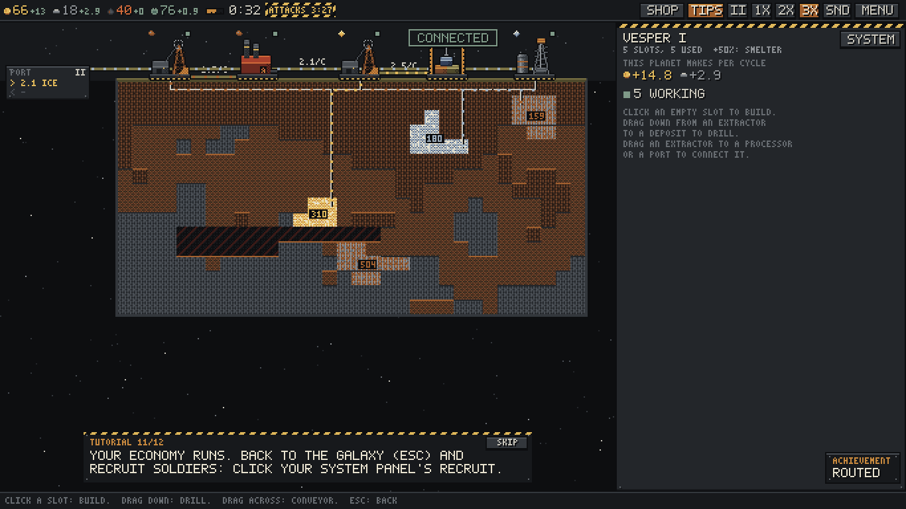

# Atlas Syndicate

**Drill and refine on your planets, route what you dig between them, turn the output into an army, and take the galaxy while five AI rivals try to take it from you.**

A pixel-art strategy game for the browser. 25–30 minute sessions. No install, no dependencies: open `index.html`.

**Play:** https://nikhildoesntcommit.github.io/Atlas-Syndicate/



## How to play

Three views: **galaxy → system → planet**. Click your system to open it, click a planet to open it, Esc goes back.

| | |
|---|---|
| **Goal** | Eliminate every rival, or hold the most systems when the 30:00 timer ends. Lose your capital and you lose. |
| **Start** | Pick a difficulty and a home at one of the six arm tips. Every home is the same, and the same distance from its rivals and the core. |
| **0:00–4:00** | Protected: nobody can attack anybody. The tutorial runs here. |
| **Planet view** | A side-on cross-section. **Click an empty surface slot** to build. **Drag down from an extractor** to a deposit to drill: the drill follows your pointer cell by cell, hard rock costs more, barriers can't be crossed, and the price shows live. **Drag an extractor across** to its processor to lay a conveyor. Deposits are visible and show what's left; deeper ones are richer. |
| **Resources** | **Metal** → mine → smelter → **alloy** (buildings, repairs, warships, platforms). **Gold** → gold mine → mint → **credits** (salaries, recruits, pathways, upgrades, buying systems). **Ice** → ice drill → water plant → **food** (soldier rations, population). **Crude** → fuel pump → refinery → **fuel** (every army move, warship upkeep). Processors work 50% better on matching planet types. |
| **System view** | **Drag from one planet to another** to open a pathway. A pathway is only a road: each end gets a port on the planet's left edge. Connect an extractor to a port, and on the other planet connect the port to a processor. Use it when a planet runs out of slots, or when another planet suits the processor better. |
| **Pressure** | Deposits run dry. Everything wears out and stops at 0% until repaired with credits and alloy (a wrench appears on the building; auto-repair is on by default). Every building shows a status light and one line of reason: *Working · Idle: no input · Blocked: no processor connected · Deposit empty · Broken: repair*. |
| **Army** | Recruits cost credits now, then salary (credits) and rations (food) every cycle. Out of credits: desertion. Out of food: soldiers fight at 75%, then desert. Out of fuel: armies can't move. Each shortfall is warned before it happens. |
| **War** | Drag from your system onto a neighbour: the order panel shows the odds, the expected losses and the fuel cost; choose how many, then Attack or Raid. Battles resolve in seconds of visible dice. Captured systems keep their buildings, broken. Taking a rival's capital eliminates it and hands you everything it owned. |
| **Coalitions** | When any faction (you included) holds 35% of the galaxy, everyone else declares a truce, may cross each other's territory, and strikes the leader together on a shared clock. |
| **Endgame** | From 18:00 capitals lose their defence bonus, and rivals go for each other's capitals. |
| **Shop** | Twenty permanent upgrades in four tracks (Extraction, Processing, Logistics, Military), bought in order with credits and alloy. |
| **Events** | Every ~4 minutes, announced 60 s ahead: solar storm, gold rush, mercenary surplus, lane collapse, pirate surge. |

### Controls

| Action | Mouse / touch | Keys |
|---|---|---|
| Open a system / planet | click / tap | |
| Back | right-click | Esc |
| Build | click an empty slot, then a building | |
| Drill | drag down from an extractor to a deposit | |
| Conveyor | drag an extractor to a processor or a port; a port to a processor | |
| Pathway | drag between two planets (system view) | |
| Move or attack | drag from your system onto another (galaxy) | |
| Upgrade shop | SHOP button | U |
| Pause (orders still work) / speed | II, 1X 2X 3X | Space, 1 2 3 |
| Pan / zoom the galaxy | drag, wheel, pinch | WASD / arrows, Q / E |
| Tips, sound, menu | buttons | T, M, Esc |

**UI scale** (Settings): 100%, 125%, 150% or 200%. The default follows your screen. Pixels stay whole, so each step rounds to the nearest whole-pixel size that fits. **Saved game**: Settings → Saved game → DELETE, then CONFIRM. Saves from older versions are removed automatically, with a notice.

## How the AI works

Five rivals: **Warlord** (aggressive; rolls over weaker neighbours, hits the strongest only at good odds), **Merchant** (big economy, buys systems, hits hard late), **Turtle** (fortifies chokepoints, punishes over-extended attackers), **Opportunist** (hits whoever just lost a battle or left a system thin) and **Raider** (strikes that wreck buildings, then retreats).

All five run **the same code** (`js/sim/ai/brain.js`); a personality is just a set of weights (`js/sim/ai/personalities.js`). Every few seconds each rival:

1. **Perceives** the map through its own fog of war: exact numbers only for its systems and their neighbours.
2. **Scores its options** (repair, build a chain, upgrade, recruit, buy, attack X, reinforce Y, retreat, save) with one formula per option type, weighted by personality.
3. **Acts** through `S.act()`, the same entry point your clicks use, under the same costs.

**Economy:** a chain's score is what it produces per cycle (valued by how short the faction is of alloy, fuel, food or credits) × the cycles it will run before the deposit is empty, divided by its cost. The AI builds exactly as you do: it places an extractor, drills the cheapest path around barriers, places a processor here or (when slots run out) on another planet through a pathway and its ports, and connects them. It repairs before things break, and it keeps fuel and food for its army.

**War:** it reinforces exposed borders first, stages attacks (gathers, holds massed so you get a warning, then strikes all at once), launches only when the battle model's odds meet its threshold, and retreats from fights that turn. In a coalition, members ignore each other, pool toward the leader through each other's territory, and strike together. From 18:00, adjacent rival capitals become the priority.

**Difficulty:** every level runs the same full, fair economy rules. Easy rivals think every ~15 s, take one economy step per think, often pick a worse target, coordinate from one system, attack less and need much better odds. Normal rivals think every ~6 s and take two steps. Hard rivals think every ~2.5 s, coordinate from three systems, accept slightly worse odds, and earn **+15% credits (the only stated bonus)**.

**`?aidebug`** overlays each rival's current plan (target, staging system, strength needed vs gathered), its stocks and income, and its last ten decisions with their scores. D hides it.

## Verification

Measured, not claimed: [`docs/verification.md`](docs/verification.md) has every number (AI tournament with a coalition A/B, the average-player test, economy sanity, fuzzing, determinism and the browser test), including the targets that were missed.

```
node tests/run-headless.js              # everything (about 15 minutes on a laptop)
node tests/run-headless.js tournament   # 210 all-AI games + the same games with coalitions off
node tests/run-headless.js player       # scripted average player on Easy / Normal / Hard
node tests/run-headless.js economy      # 50 seeds: production matches claims, no long idling, every resource used
node tests/run-headless.js fuzz         # random player actions incl. drilling, conveyors, ports
node tests/run-headless.js replay       # same seed + same actions = identical state; save/resume identical
open tests/selftest.html                # the rule checks in a browser (also ?selftest=1)
node tests/browser-test.js --size 1366x768 --shots docs   # headless browser run (needs: npm i -D playwright)
```

## Presentation helpers

- `?demo` — attract mode: opens in the galaxy on a battle, then cuts into a busy planet. `?demo&from=600` starts 10 minutes in.
- `?aidebug` — the AI debug overlay (combine with `?demo`).
- `?seed=12345` — a specific galaxy. `?code=...` — a share code from an end report (seed and difficulty).
- **F9** (hidden) — the AI plays your side until 15:00, then hands it back.
- `?speed=4` — run the simulation faster.

## Running locally

Double-click `index.html`. Classic `<script>` files and one global namespace (`AS`): no modules, no build step, no CDNs, no downloaded assets. Every sprite, both pixel fonts and all sound and music are generated in code. A local web server works too (`python3 -m http.server`).

## Publishing on GitHub Pages

1. Push to `main` on GitHub.
2. Settings → Pages → Source: **GitHub Actions**.
3. `.github/workflows/pages.yml` runs the self-test, determinism and fuzz checks, then publishes `index.html`, `favicon.svg`, `css/` and `js/` (`.nojekyll` included). The site appears at `https://<user>.github.io/Atlas-Syndicate/`.

Each deploy stamps the commit into every script and stylesheet URL (`?v=<commit>`), so browsers always load the new version instead of a cached one.

## Repository

```
index.html  favicon.svg  .nojekyll  css/style.css
js/config.js        every tunable number, palette, resources, buildings, upgrades, events, difficulty
js/util.js          seeded RNG, maths, formatting, guarded storage, share codes
js/sim/             planet.js (cross-sections, drilling) galaxy.js economy.js (flows) combat.js upgrades.js
                    events.js sim.js (coalitions, warnings) actions.js selftest.js
js/sim/ai/          brain.js (shared decision system), personalities.js (weights)
js/render/          font.js sprites.js core.js galaxy.js system.js planet.js hud.js fx.js debug.js
js/ui/              actions.js tutorial.js screens.js input.js
js/audio/           sfx.js music.js (procedural WebAudio)
js/main.js          loop, views, ?demo director, F9
tests/              run-headless.js average-player.js browser-test.js selftest.html
docs/               screenshots, verification.md
```

## What changed from v5

v5's building side didn't feel like building: supply lines between orbiting planets were abstract. v6 replaces it with a hands-on planet view. Removed: in-system supply lines, stations and freighters; the ORE/ENERGY/FOOD factory economy; corporations; drafted cards. New: planet cross-sections with visible deposits, drilling around hard rock and barriers, conveyors, ports and pathways; four resources that each matter (credits, alloy, fuel, food); fuel and rations for armies; the upgrade shop; real coalitions; the 18:00 capital endgame; symmetric, fair starts; status lights and reasons on everything; one warning at a time; the UI scale setting; `?aidebug`. Kept: the galaxy, military, visual identity, procedural audio and the tech base.

## AI tools used

Designed by the author; implemented, tested and tuned with **Claude Code** (Anthropic's coding agent, model Claude Opus 5.5), including the headless AI tournament used to balance the rivals.
