# Atlas Syndicate

**Submission by:** Nikhil Shukla

**AI Innovator Game Presentation**

**AI Tools Used:** Claude Code for development, ChatGPT for brainstorming, and Manus AI and Lovable for V1 and V2 of the app respectively.

---

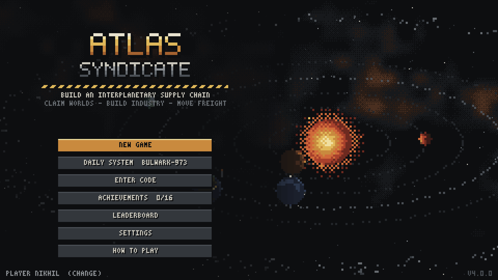

**A pixel-art arcade strategy game about building an interplanetary supply chain.**
Claim worlds, build mines and factories, and keep the Board happy while you build a jump gate in each of three star systems.

### ▶ [Play it in your browser](https://nikhildoesntcommit.github.io/Atlas-Syndicate/)

No install, no account, no downloads. It works on desktop and on phones and tablets.

---

## Contents

- [The game](#the-game)
- [Screenshots](#screenshots)
- [How to play](#how-to-play)
- [Controls](#controls)
- [Game dynamics checklist](#game-dynamics-checklist)
- [Features](#features)
- [How it was built with AI](#how-it-was-built-with-ai)
- [Under the hood](#under-the-hood)
- [Testing and quality](#testing-and-quality)
- [Run it locally](#run-it-locally)

---

## The game

Atlas Syndicate drops you into a star system with a single world, **Atlas Prime**.
You claim more worlds and build on them. Each new world links itself to the capital, freighters decide for themselves where to fly and what to carry, and every good that reaches Atlas Prime is sold.

Every three minutes the **Board** reviews your revenue against a target that keeps rising, and you pick one of three perks. Hit the target and confidence rises; miss it and confidence falls. If confidence reaches zero, the run is over.

Every run is a **campaign across three star systems**. In each one, new worlds are discovered as you play and a **jump gate** unlocks after a few minutes. Feed it three stages of goods and it opens: you warp into the next, harder system with your credits, perks and fleet. Open the third gate to win.

Two abilities keep your hands busy: **BOOST** sends every freighter at double speed for a few seconds, and **DEFLECT** shoots down a meteor during its 8-second warning.

Every system is generated from a seed, so no two runs are the same. You can share any run with a short code so a friend can play the exact same system.

---

## Screenshots

| | |
| :---: | :---: |
| 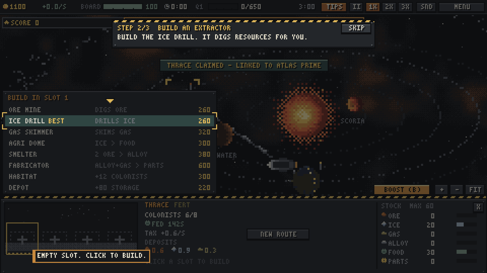 | 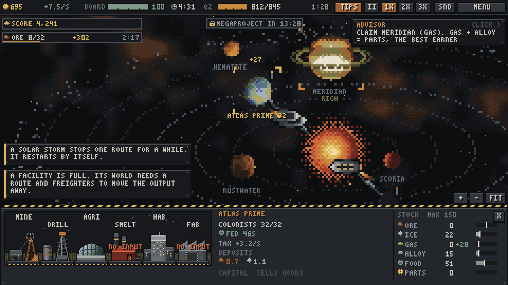 |
| **A guided first minute.** Three highlighted steps; the best build is marked. | **An early colony.** Atlas Prime's facilities, stock and colonists. |
| 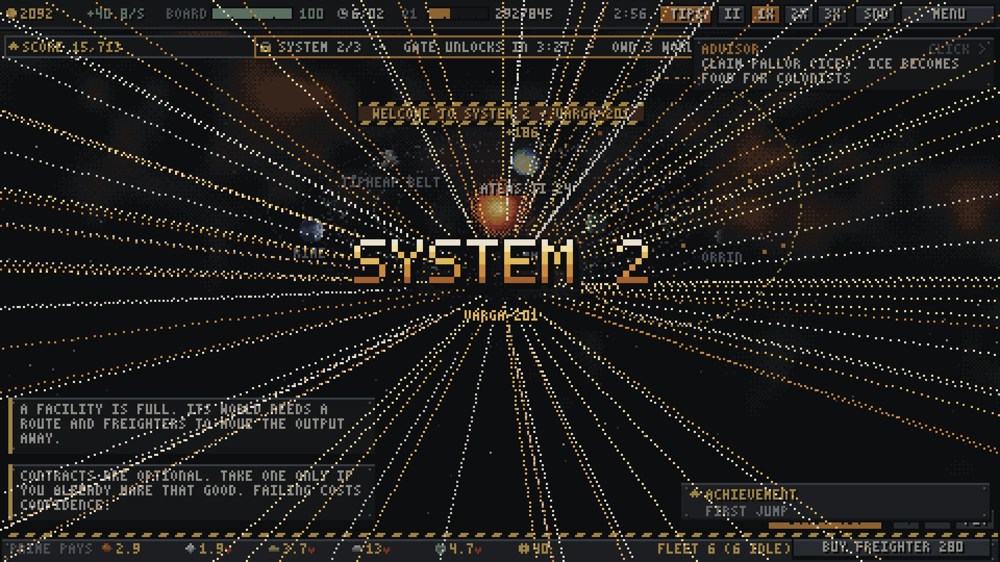 | 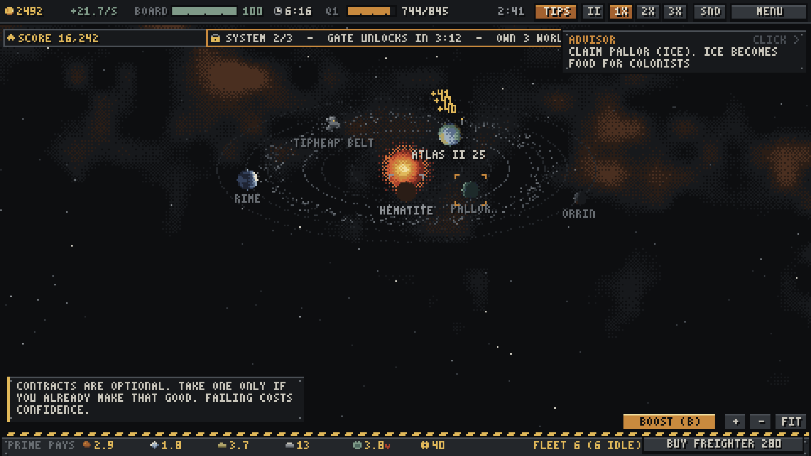 |
| **The warp.** Each finished gate jumps you to a new system. | **System 2.** A fresh map, harder targets, your fleet comes along. |
| 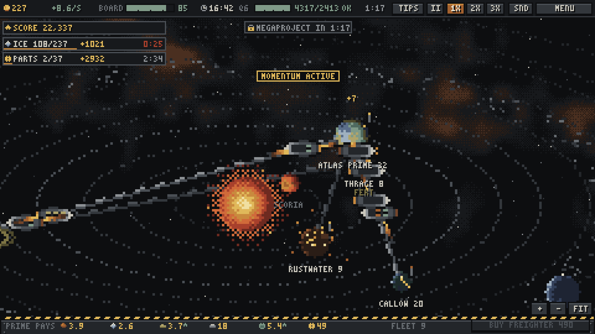 | 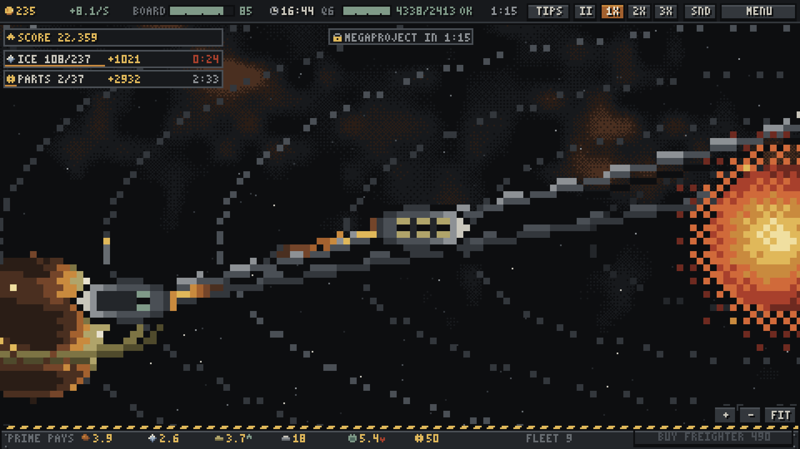 |
| **A busy network.** Freighters carry cargo between worlds. | **Close-up.** Cargo pods, engine trails, lights on inhabited worlds. |
| 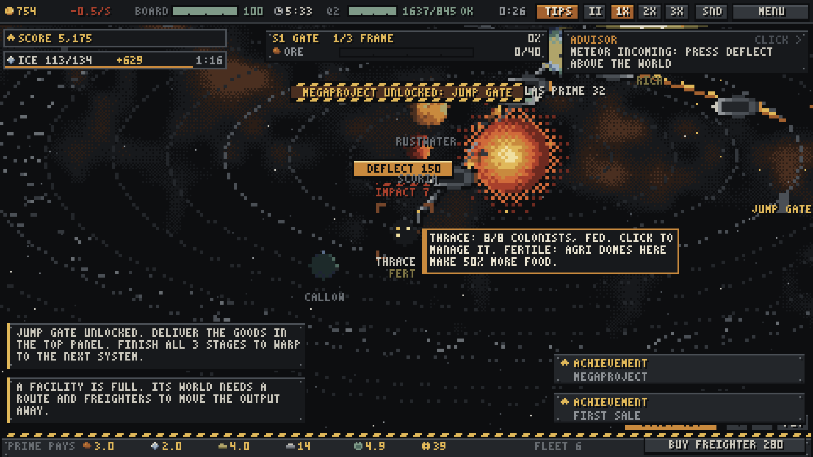 | 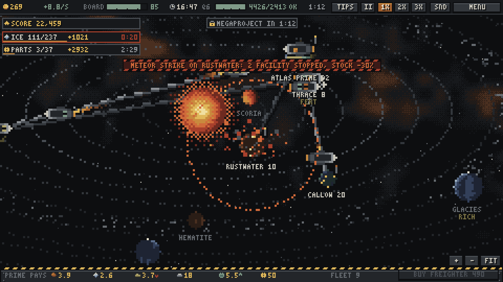 |
| **DEFLECT.** Shoot down a meteor during its warning. | **Or take the hit.** Shock rings, debris and lost stock. |
| 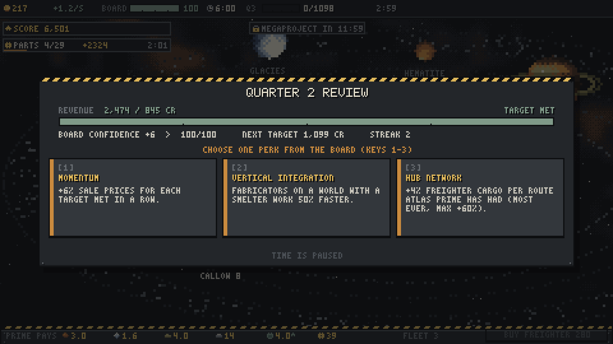 | 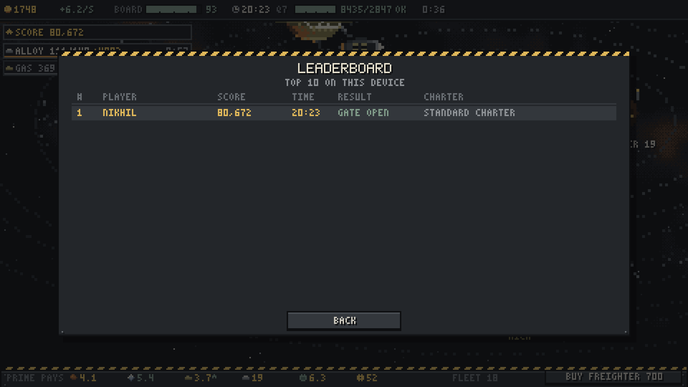 |
| **The quarterly review.** Hit the target, then pick one perk. | **The leaderboard.** Your best runs on this device. |
| 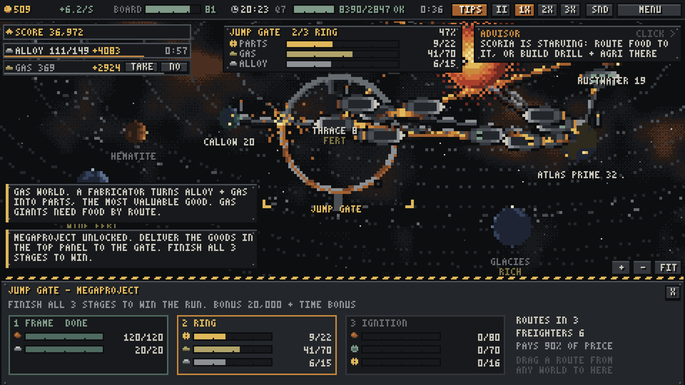 | 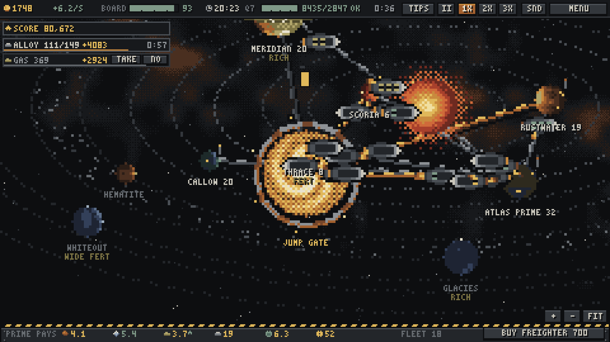 |
| **The jump gate.** Three stages of deliveries build it. | **The gate opens.** Next stop: a new system. |
| 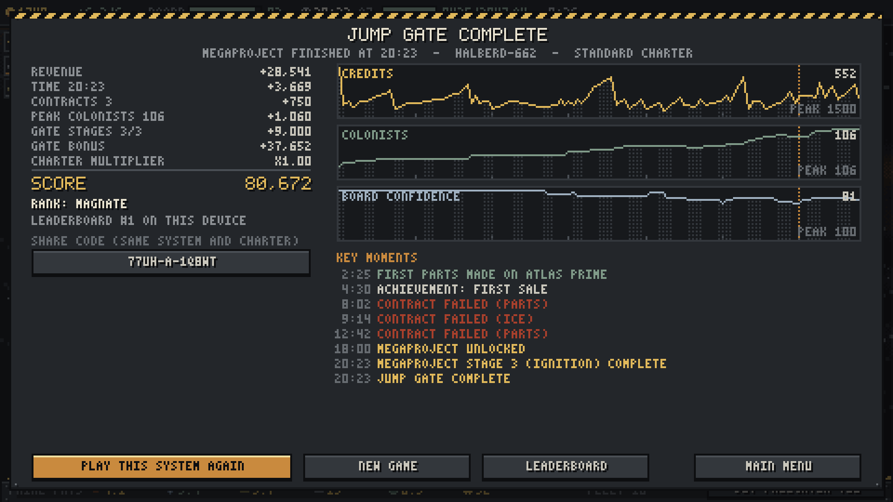 | 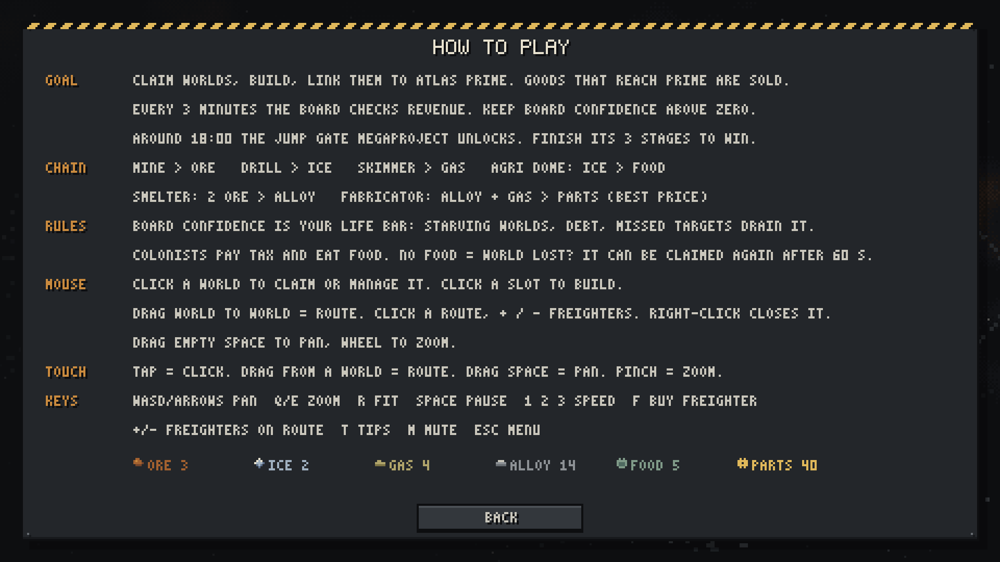 |
| **The report.** Charts, key moments and a share code. | **How to play.** Every rule and control on one screen. |

---

## How to play

1. **Claim a world.** Click a world and press **CLAIM**. It links itself to Atlas Prime and a freighter starts work. Worlds with ice can feed themselves; gas giants need food delivered.
2. **Build.** Click an empty slot and choose a facility. The menu marks the **BEST** choice for that world.
3. **Let it run.** Freighters choose their own routes and cargo. Buy more with **F** when worlds fill up; press **B** to **BOOST** them.
4. **Sell.** Everything that reaches **Atlas Prime** is sold. Raw goods sell cheaply; refined **alloy** and **parts** pay much more.
5. **Survive the Board.** Meet each quarter's revenue target. Starving worlds, debt and failed contracts all drain Board confidence, your life bar.
6. **Build the gate, warp on.** The goal line at the top says when the jump gate unlocks. Deliver its three stages to warp to the next system. Open all three gates to win.

```
MINE → ORE ──┐                  SMELTER: 2 ORE → ALLOY
DRILL → ICE ─┼─ freight ─→ ...   AGRI DOME: ICE → FOOD (keeps colonists alive)
SKIMMER → GAS┘                  FABRICATOR: ALLOY + GAS → PARTS (best price)
                                 everything delivered to ATLAS PRIME is sold
```

**You lose** when Board confidence reaches zero. **You win** when the third system's jump gate is complete.
A world whose colonists starve is lost; you can claim it again after 60 seconds. A lost run can be replayed on the same system with one click.

---

## Controls

| Action | Mouse | Touch | Keyboard |
| --- | --- | --- | --- |
| Claim or manage a world | Click it | Tap it | |
| Build | Click an empty slot in the bottom panel | Tap the slot | |
| Extra freight route | Select a world, **NEW ROUTE**, click the other world | Same, with taps | `Esc` cancels |
| Add or park freighters | Click a route, then `+` or `-` | Tap a route, then `+` or `-` | `+` / `-` |
| Close a route | Right-click it | Tap it, then CLOSE ROUTE | `Delete` |
| Pan the map (glides when you let go) | Drag anywhere | Drag anywhere | `W A S D` or arrow keys |
| Zoom (smooth) | Mouse wheel, or double-click to zoom in | Pinch, or double-tap | `Q` / `E`, `R` to fit |
| Boost freighters | **BOOST** button | **BOOST** button | `B` |
| Deflect a meteor | **DEFLECT** above the warned world | Tap **DEFLECT** | |
| Pause, game speed | Top bar | Top bar | `Space`, `1` `2` `3` |
| Buy a freighter | Bottom bar | Bottom bar | `F` |
| Tips and advisor | `TIPS` | `TIPS` | `T` |
| Sound, menu | `SND`, `MENU` | | `M`, `Esc` |

Settings for pixel size, screen shake, tips, music volume and effects volume are on the title screen and in the pause menu.

---

## Game dynamics checklist

How Atlas Syndicate covers each game-dynamics area.

### Core

| # | Area | In Atlas Syndicate |
| --- | --- | --- |
| 1 | **Enter player name** | Asked on first launch; it can be changed from the title screen or Settings. It appears on the leaderboard. |
| 2 | **Main menu** | Continue, New Game, Daily System, Enter Code, Achievements, Leaderboard, Settings, How to Play. |
| 3 | **Start button, controls description** | NEW GAME starts a run. **How to Play** lists the goal, production chain, rules and every control (mouse, touch, keyboard). |
| 4 | **Player, controls** | You run the company: click, drag, tap, pinch, or the keyboard shortcuts above. Two abilities: BOOST and DEFLECT. |
| 5 | **Collectibles** | Six goods (ore, ice, gas, alloy, food, parts), credits, perks and 18 achievements. |
| 6 | **Obstacles** | 11 event types (solar storms, solar flares, meteor strikes you can DEFLECT, cargo loss, breakdowns, crop blight, fuel shortages, price swings), plus starvation, debt and rising targets. |
| 7 | **Game rules** | Meet each quarter's target, keep worlds fed, stay out of debt. Confidence 0 = game over; jump gate complete = win. |
| 8 | **Game background** | Procedurally generated star systems: a dithered nebula, a parallax starfield, orbit lines, a drifting asteroid belt, and planets that rotate under a moving day/night line. |
| 9 | **Game audio** | 32 synthesised sound effects and an industrial soundtrack that adds layers as the run gets tense. Separate music and effects volume, plus mute. |
| 10 | **Play screen: score, timer, lives** | Live **score** (top left), run **timer** and quarter countdown (top bar), and **Board confidence** as the life bar. |
| 11 | **Respawn rule** | A world lost to starvation can be claimed again after 60 seconds. A lost run can be replayed on the same system. Closed tabs resume from an autosave. |

### Intermediate

| # | Area | In Atlas Syndicate |
| --- | --- | --- |
| 1 | **Multiple levels** | **Three star systems per run**, each a level with its own map, rising targets and jump gate; the gate warps you to the next. Within a system every 3-minute quarter raises the target. Eight charters change the rules, and a Daily System is the same for everyone each day. |
| 2 | **Level design** | A seeded generator builds every system: ice and ore near the start, a gas giant as the first discovery, richer worlds further out, and world traits (rich seam, radiation, low gravity and more). |
| 3 | **Challenge design: boss fight** | Every system ends with a **jump gate** boss: three stages of deliveries while targets and events escalate. Each gate asks for harder goods (basics, then gas, then parts); the third is the final boss. |
| 4 | **Leaderboard** | Top 10 on this device, with player, score, time, result and charter. |
| 5 | **Shops** | The **quarterly review** offers 3 of 23 perks. The build menu (8 facilities) and freighter purchases are the everyday shop. |
| 6 | **Cut scene / explanation** | A three-step guided opening, a goal line, an advisor panel and one-time explanation cards. Each gate plays a finale and a warp sequence into the next system. (No characters or story, by design.) |
| 7 | **Game physics** | Worlds follow Kepler-style orbits, so route distances and trip times change constantly. Freighters accelerate and brake; BOOST doubles their speed. The camera has momentum and smooth zoom. Particles have gravity. Three game speeds. |

### Advanced

| # | Area | In Atlas Syndicate |
| --- | --- | --- |
| a | **Multiplayer** | Not real-time multiplayer. Players compete asynchronously instead: the **Daily System** gives everyone the same map each day, and **share codes** let a friend replay your exact system and try to beat your score. |

---

## Features

- **Three systems per run.** Each has its own generated map and jump gate; finishing one warps you to the next, harder system.
- **Automatic logistics.** New worlds link to the capital by themselves, freighters assign themselves to the routes that need them, and Atlas Prime holds goods for the gate and for connected worlds.
- **Things to do in the moment.** BOOST your fleet when a quarter or a gate is close; DEFLECT meteors before they hit.
- **Replayability.** 8 charters, 23 perks with synergies, 7 world traits, 11 event types, a Daily System and 18 achievements.
- **End-of-run report.** Pixel charts of credits, colonists and Board confidence over time, the key moments of the run, a rank, and a share code.
- **Juice.** Engine trails, construction scaffolding and sparks, floating credits, numbers that count up, screen shake, hazard-stripe warnings and buttons that press in.
- **Accessible.** Colour is never the only signal: goods have distinct icon shapes, and states always come with a word or symbol. Adjustable pixel size and optional screen shake.
- **Smooth controls.** Drag anywhere to pan (with momentum), smooth animated zoom, double-click to zoom in. Mouse, keyboard and touch. It autosaves, so a closed tab resumes where you left off.
- **Zero downloads.** Every sprite, font glyph, sound and note of music is generated in code. No images, audio files, fonts or libraries.

---

## How it was built with AI

| Version | Tool | What it was |
| --- | --- | --- |
| Brainstorming | **ChatGPT** | Game concept, mechanics and naming ideas |
| V1 | **Manus AI** | First playable version |
| V2 | **Lovable** | Second version of the app |
| V3 | (Arcade Edition) | Single-file arcade prototype |
| V4 (this repo) | **Claude Code** | Full rebuild: architecture, game systems, art, audio, onboarding, testing and balancing |

The V4 workflow paired human direction with AI implementation. I set hard rules (no story, an industrial colour palette, no outside assets, the game before the slides) and asked for proof rather than claims. The AI built the game, then verified it: it simulated hundreds of games with a built-in player, fuzzed thousands of random actions, and looked at real screenshots. Testing caught real bugs that reading the code had not:

- Goods held at Atlas Prime for the gate were never shipped.
- The original economy was so tight that the built-in player went broke at 22 minutes.
- A dimming effect made on-screen text unreadable.

---

## Under the hood

```
             actions                    state
  YOU ───────────────┐         ┌──────────────────→ SCREEN & SOUND
  BUILT-IN PLAYER ───┼──→ SIMULATION ──┘             (canvas renderer, WebAudio)
  TESTS (Node) ──────┘    seeded · deterministic · no DOM
```

- **One deterministic simulation** (`js/sim/`) runs the whole game at a fixed 20 steps per second with a seeded random generator. The same seed plus the same actions always produces the same game, so runs can be replayed, saved and shared.
- **Three users of one simulation:** you (through the UI), the built-in player (attract mode and testing), and the Node test runner. They all act through the same single entry point.
- **Pixel-perfect rendering.** A low-resolution canvas (480×270 or larger) is scaled by whole numbers only, so pixels stay crisp on any screen. Planets are shaded per pixel from generated textures; sprites and both pixel fonts are drawn from code.
- **Procedural audio.** Every sound effect is synthesised with the Web Audio API, and the soundtrack is a step sequencer with five layers that fade in with intensity.
- **No build step.** Plain JavaScript files loaded with classic `<script>` tags under one global namespace, so the game runs from GitHub Pages or straight from your file system.

**Technologies:** HTML5 Canvas 2D, Web Audio API, Pointer Events, localStorage, Node.js (tests), GitHub Actions and GitHub Pages.

---

## Testing and quality

Every number below comes from the included test runner (`node tests/run-headless.js`). Details: [docs/verification.md](docs/verification.md).

| Check | Result |
| --- | --- |
| Self-test (300 generated systems, all 8 charters, save/resume, replay) | Pass |
| Determinism: recorded games replayed from their action logs | Identical state, 3 of 3 |
| Fuzz test: random, often invalid player actions | 26,778 actions, 140 save/load round trips, **0 failures** |
| Balance: 8 charters × 10 seeds with the built-in skilled player | 96% reach the gate, 79% finish it, median **27 minutes** |
| Balance: a careless player (casual bot) | 85% reach the gate, 3% finish it, most lose around 23 minutes |
| Balance: a player who does nothing | Always loses |
| Browsers | Chromium and Firefox: full playthrough, 0 console errors. Steady 60 fps at 1080p. |

---

## Run it locally

No build step and nothing to install.

- **Double-click `index.html`**, or
- serve the folder: `python3 -m http.server 8000`, then open <http://localhost:8000>.

<details>
<summary><b>Extras: demo mode, shared systems, tests</b></summary>

| Link or key | What it does |
| --- | --- |
| `index.html?demo` | Attract mode: the built-in player plays on its own with camera moves. `&from=600` starts it ten minutes in; `&speed=8` makes it faster. `Esc` leaves. |
| `index.html?seed=12345` | Play a specific system. |
| `index.html?code=…` | Play a system from a share code (shown on the end-of-run report). |
| `F9` during a game | Skip ahead to the current system's jump gate; press again to fill it to 90% and watch it open and warp. |
| `tests/selftest.html` | Run the self-test in the browser. |

Run the tests with Node 16 or newer (no packages needed):

```sh
node tests/run-headless.js            # self-test, determinism, fuzz and balance
node tests/run-headless.js balance --seeds 10
```

Project layout:

```
index.html          the page: one canvas and the script tags
js/config.js        every tunable number, the 32-colour palette and the game data
js/util.js          seeded random numbers, formatting, share codes, storage
js/sim/             the deterministic simulation and the built-in player
js/render/          pixel fonts, sprites, camera, world, HUD, effects
js/ui/              menus, onboarding, tips and advisor, input
js/audio/           sound effects and the procedural soundtrack
js/main.js          start-up and the game loop
tests/              browser self-test and the Node test runner
```

</details>
