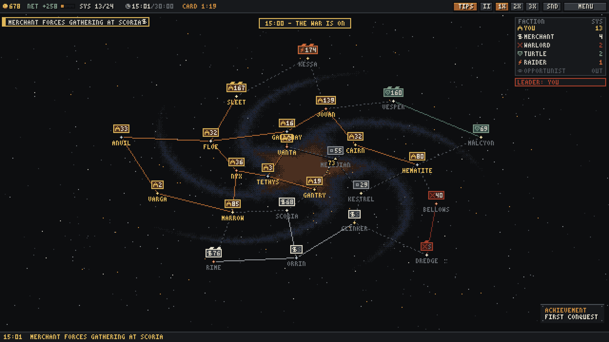

# Atlas Syndicate

**Build your star system's supply lines, turn the income into an army, and take the galaxy, while five AI rivals try to take it from you.**

A pixel-art strategy game for the browser. 25–30 minute sessions. No install, no dependencies: open `index.html`.

**Play:** https://nikhildoesntcommit.github.io/Atlas-Syndicate/



## How to play

| | |
|---|---|
| **Goal** | Eliminate every rival, or hold the most systems when the 30:00 timer ends. Lose your capital and you lose. |
| **Start** | Pick a difficulty, a corporation (one strong ability) and a home system in the outer arms. |
| **0:00–4:00** | Protected: nobody can attack anybody. The tutorial runs here. |
| **System view** | Click your system. Click a planet to build an extractor. Drag station → planet → planet to draw a supply line. ORE + ENERGY at the factory make credits; FOOD grows population, which multiplies output. Only complete chains pay. A line needs one freighter per stop after the first. |
| **Money** | Every 10 s cycle: income − salaries − repairs. The next cycle's net is always in the top bar. Go below zero: a warning, then soldiers desert. Buildings wear out and stop at 0%; repair them (auto-repair is on by default). |
| **Galaxy view** | Armies are numbers and move only along lanes. Drag from your system onto a neighbour: the order panel shows the odds ("68% to win, expected losses 4–7"), you choose how many to send, then Attack or Raid. Battles resolve in a few seconds of visible dice rounds. |
| **Expansion** | Conquer a neighbour (cheap, costs soldiers) or buy an independent system (peaceful, buildings intact, expensive; the price rises with every system you own). Captured systems keep their buildings, damaged: repair them to put them to work. Taking a rival's capital eliminates it and hands you all its systems. |
| **Cards** | Every 3 minutes, and after capturing a rival system, draft 1 of 3 upgrade cards (30 in the pool, with real combos). |
| **Events** | Every ~4 minutes, announced 60 s ahead: solar storm, market boom, mercenary surplus, lane collapse, pirate surge. |
| **Warnings** | Top left: rivals massing on your border, armies inbound, battles in your systems. Click to look. |

### Controls

| Action | Mouse / touch | Keys |
|---|---|---|
| Open your system | click / tap it | |
| Move or attack | drag from your system onto another | |
| Build extractor | click a planet | |
| Draw / extend a line | drag between station and planets | Del removes the selected line |
| Back to galaxy | right-click | Esc |
| Pan / zoom | drag empty space, wheel, pinch | WASD / arrows, Q / E |
| Pause (orders still work) | II button | Space |
| Speed 1× / 2× / 3× | buttons | 1 2 3 |
| Tips, sound, menu | buttons | T, M, Esc |

## How the AI works

Five rivals: **Warlord** (aggressive, hits its strongest neighbour), **Merchant** (big economy, buys systems, fights when attacked or when the odds are overwhelming, hits hard late), **Turtle** (fortifies chokepoints, punishes over-extended attackers), **Opportunist** (hits whoever just lost a battle or left a system thin) and **Raider** (fast strikes that wreck buildings, then retreat).

All five run **the same code** (`js/sim/ai/brain.js`); a personality is just a set of weights (`js/sim/ai/personalities.js`). Every few seconds each rival:

1. **Perceives** the map through its own fog of war: exact numbers only for its systems and their neighbours, size bands (S/M/L) elsewhere. No cheating.
2. **Scores its options** (repair, build, recruit, buy, attack X, reinforce Y, retreat, save) with one formula per option, weighted by personality.
3. **Acts** through `S.act()`, the same entry point your clicks use, under the same costs, salaries, durability and cards.

Tactics come out of the scoring: it reinforces exposed borders before attacking elsewhere; it **stages** attacks (gathers at a border, holds massed for a few seconds, then strikes all at once), so you see the build-up and get a warning; it only launches when the battle model's odds meet its threshold; it pulls out of battles that turn; it caps salaries to its income and repairs before things break; it notices weakened targets; and anyone holding 35% of the galaxy becomes everybody's priority target (**leader pressure**). Difficulty changes reaction speed, odds thresholds, coordination and appetite; only Hard adds a stated bonus (+15% rival income). AI work is spread across frames: each faction thinks on its own staggered timer.

## Verification

Measured, not claimed: see [`docs/verification.md`](docs/verification.md) for the full numbers (AI tournament of 210 games plus a leader-pressure A/B, the average-player test, fuzzing, determinism and the browser test).

```
node tests/run-headless.js              # everything (about 10 minutes on a laptop)
node tests/run-headless.js tournament   # 210 all-AI games + the same games with leader pressure off
node tests/run-headless.js player       # scripted average player on Easy / Normal / Hard
node tests/run-headless.js fuzz         # random player actions: no crashes, NaN or broken invariants
node tests/run-headless.js replay       # same seed + same actions = identical state; save/resume identical
open tests/selftest.html                # the rule checks in a browser (also ?selftest=1)
node tests/browser-test.js --shots docs # headless browser run (needs: npm i -D playwright)
```

## Presentation helpers

- `?demo` — attract mode: the AI plays your faction while the camera follows the action. `?demo&from=420` starts 7 minutes in.
- `?seed=12345` — a specific galaxy. `?code=...` — a share code from an end report (seed, corporation, difficulty).
- **F9** (hidden) — the AI plays your side until 15:00, then hands it back: a plausible mid-war state in a few seconds.
- `?speed=4` — run the simulation faster.

## Running locally

Double-click `index.html`. That's it: classic `<script>` files and one global namespace (`AS`), no modules, no build step, no CDNs, no downloaded assets. Every sprite, the pixel font and all sound and music are generated in code. A local web server works too (`python3 -m http.server`).

## Publishing on GitHub Pages

1. Push to `main` on GitHub.
2. Settings → Pages → Source: **GitHub Actions**.
3. `.github/workflows/pages.yml` runs the self-test, determinism and fuzz checks, then publishes `index.html`, `favicon.svg`, `css/` and `js/` (`.nojekyll` included). The site appears at `https://<user>.github.io/Atlas-Syndicate/`.

## Repository

```
index.html  favicon.svg  .nojekyll  css/style.css
js/config.js        every tunable number, palette, factions, corporations, cards, events, difficulty
js/util.js          seeded RNG, maths, formatting, guarded storage, share codes
js/sim/             galaxy.js economy.js combat.js cards.js events.js sim.js actions.js selftest.js
js/sim/ai/          brain.js (shared decision system), personalities.js (weights)
js/render/          font.js sprites.js core.js galaxy.js system.js hud.js fx.js
js/ui/              actions.js tutorial.js screens.js input.js
js/audio/           sfx.js music.js (procedural WebAudio)
js/main.js          loop, lifecycle, ?demo director, F9
tests/              run-headless.js average-player.js browser-test.js selftest.html
docs/               screenshots, verification.md
```

## What changed from v4

v4 was a supply-chain game where the game made the decisions: playtesters found it confusing and not fun. v5 is a new game on v4's foundations. Kept: the 32-colour palette, pixel fonts, planet and sprite generators, riveted panels and hazard stripes, integer scaling, procedural sound and music, settings, touch input, autosave, achievements, the headless test runner and the Pages workflow. Removed: the board-confidence meter, contracts, quarterly targets, megaprojects, the three-system campaign, automatic freighter routing and the leaderboard. New: the galaxy and its rivals, the system view with player-drawn supply lines, armies and battles with visible odds, corporations, cards and events.

## AI tools used

Designed by the author; implemented, tested and tuned with **Claude Code** (Anthropic's coding agent, model Claude Opus 5.5), including the headless AI tournament used to balance the rivals.
